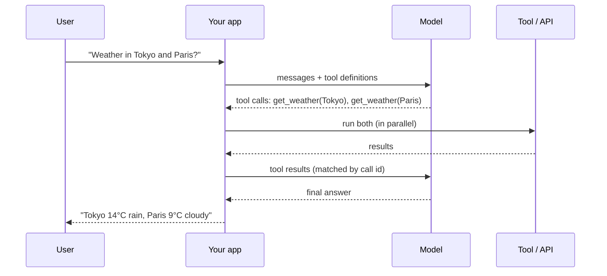

# What is Function Calling

**Function calling** (also called **tool calling** or **tool use**) lets a language model ask your application to run a function, using arguments it fills in from the conversation. The application runs the function and sends the result back. The model then answers, or calls another tool.

!!! info "The model never executes anything"
    The model only outputs a structured request, usually a function name plus JSON arguments. **Your code** decides whether to run it, runs it, and returns the result. This is what makes tool calling safe to control and easy to audit.

## The loop

1. **Define tools**: a name, a description, and a [JSON Schema](https://json-schema.org/) for the parameters.
2. **Send** the conversation plus the tool definitions.
3. **The model replies** with text, one or more tool calls, or both.
4. **Your app validates and runs** each call.
5. **Return the results**, each matched to its call id.
6. **Repeat** until the model replies without a tool call. See [Using Function Calling](usage.md).

## Terminology

| Term | Meaning |
|---|---|
| Function calling / tool calling / tool use | Same idea, different vendor wording. "Function calling" (OpenAI, Gemini), "tool use" (Anthropic), "tool calling" (most frameworks) |
| Tool definition | Name + description + parameter schema sent to the model |
| Tool call | The model's request: name + arguments + id |
| Tool result | What your code returns for a call, linked by id |
| `tool_choice` | Controls whether the model may, must, or must not call tools |
| Parallel calls | Several independent calls in one model turn |
| Strict mode | The provider guarantees the arguments match the schema (constrained decoding) |
| Server / built-in tools | Tools the provider runs for you (web search, code execution) |
| MCP | [Model Context Protocol](mcp.md): a standard way to expose tools to any model or client |

More in the [Glossary](glossary.md).

## Kinds of tools

- **Client (custom) functions**: your code runs them. This is the classic case.
- **Server (built-in) tools**: the provider runs them, e.g. web search, code execution, file search.
- **MCP tools**: discovered from an MCP server at runtime.
- **Computer / browser use**: the model drives a UI through screenshot, click, and type tools.
- **Code-as-tool**: the model writes code that calls your tools (programmatic tool calling, "code mode").

## When to use it

| Use function calling for | Prefer something else when |
|---|---|
| Live data (weather, stock, DB lookups) | The answer is static knowledge: just prompt |
| Taking actions (book, send, update) | You only need JSON back: use [structured outputs](structured-outputs.md) |
| Multi-step agents that plan and act | One fixed pipeline step: call the API directly |
| Extracting typed data from messy input | Free-form creative text |

## Controlling calls

| Mode | Effect | Typical name |
|---|---|---|
| Auto | The model decides | `auto` / `AUTO` |
| Required | Must call some tool | `required` / `any` / `ANY` |
| Specific | Must call this tool | `{"type":"function","function":{"name":...}}` / `{"type":"tool","name":...}` |
| None | Must not call tools | `none` / `NONE` |

Exact names and differences per vendor are on [Providers Compared](providers.md). Some newer models no longer accept forced modes and expect `auto` plus a prompt instruction.

## A short history

- **Feb 2023**: [Toolformer](https://arxiv.org/abs/2302.04761) shows LMs can teach themselves to call APIs. [ReAct](https://arxiv.org/abs/2210.03629) (2022) popularized interleaving reasoning and actions.
- **Jun 2023**: OpenAI ships `functions` in the Chat Completions API. **Nov 2023**: it becomes `tools`, with parallel calls.
- **2024**: Anthropic (tool use), Google Gemini, Mistral, Cohere, and open models (Llama 3.1, Qwen 2.5, Hermes) ship native tool calling. **Nov 2024**: Anthropic open-sources the [Model Context Protocol](mcp.md).
- **2025-2026**: strict schemas, server tools, tool search over huge toolsets, MCP adoption across vendors, and agentic benchmarks (BFCL v3/v4, τ-bench).

!!! tip "See it before you build it"
    Paste a schema into the [toolcalling.ai workspace](https://app.toolcalling.ai/), ask a question, and watch the model pick tools and fill in arguments. Then vote in the [Arena](https://app.toolcalling.ai/arena).
