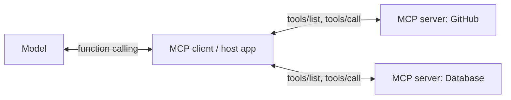

# Model Context Protocol (MCP)

[MCP](https://modelcontextprotocol.io/) is an open protocol for exposing **tools**, **resources**, and **prompts** to LLM applications. Write a tool server once and any MCP client (Claude, ChatGPT, IDEs, agent frameworks) can use it.

!!! info "MCP doesn't replace function calling"
    MCP standardizes how tools are **discovered and called** between the app and a tool server. The model still uses ordinary function calling: the client turns each MCP tool into a tool definition for the model.



## Tools in the spec

Current spec: **[2026-07-28](https://modelcontextprotocol.io/specification/2026-07-28/server/tools)** (also at [/specification/latest](https://modelcontextprotocol.io/specification/latest/server/tools)).

| Piece | Shape |
|---|---|
| Capability | `{"capabilities": {"tools": {"listChanged": true}}}` |
| Discover | `tools/list` → `{tools: [...], nextCursor}`, paginated, deterministic order, may carry cache hints (`ttlMs`, `cacheScope`) |
| Tool | `name` (1-128 chars, `[A-Za-z0-9_.-]`), `title?`, `description`, `inputSchema` (JSON Schema, 2020-12 by default), `outputSchema?`, `annotations?`, `icons?` |
| Call | `tools/call` with `{name, arguments}` → `{content: [text \| image \| audio \| resource_link \| resource], structuredContent?, isError?}` |
| Errors | Unknown tool or bad request: JSON-RPC error (e.g. `-32602`). Tool failed: `isError: true` with content, **passed to the model** so it can recover |
| Changes | `notifications/tools/list_changed` (via `subscriptions/listen` in the 2026-07-28 spec) |

A tool with no parameters uses `{"type": "object", "additionalProperties": false}`. When a tool declares an `outputSchema`, its `structuredContent` must conform to it. Also return a text copy for older clients.

## Example tool

```json
{
  "name": "search_issues",
  "title": "Search issues",
  "description": "Search issues in a repository by text. Returns at most 20 results.",
  "inputSchema": {
    "type": "object",
    "properties": {
      "repo": {"type": "string", "description": "owner/name"},
      "query": {"type": "string"},
      "state": {"type": "string", "enum": ["open", "closed", "all"], "default": "open"}
    },
    "required": ["repo", "query"],
    "additionalProperties": false
  },
  "annotations": {"readOnlyHint": true}
}
```

## Best practices

- Everything on [Schema](best-practices-for-schema.md) and [Tool Output](best-practices-for-tool-output.md) applies. MCP tool descriptions are prompts.
- **Namespace** tool names when combining servers (e.g. `github.search_issues`) to avoid collisions.
- Many servers mean many tools: use [tool search](function-pivoting-aka-tool-search.md) or expose only what the task needs.
- Treat annotations from untrusted servers as **untrusted**. Pin server versions and review tool descriptions for injected instructions ([Security](security.md)).
- **Training data**: include MCP-style tool lists (many tools, namespaced names, long descriptions) so fine-tuned models work in MCP hosts ([Fine-Tuning](fine-tuning.md)).

## Links

- [Specification](https://modelcontextprotocol.io/specification/latest) · [Security best practices](https://modelcontextprotocol.io/specification/draft/basic/security_best_practices)
- [Official SDKs](https://github.com/modelcontextprotocol) (TypeScript, Python, Java, Kotlin, C#, Go, Rust, Swift, Ruby, PHP)
- [Reference servers](https://github.com/modelcontextprotocol/servers) · [MCP Inspector](https://github.com/modelcontextprotocol/inspector)
